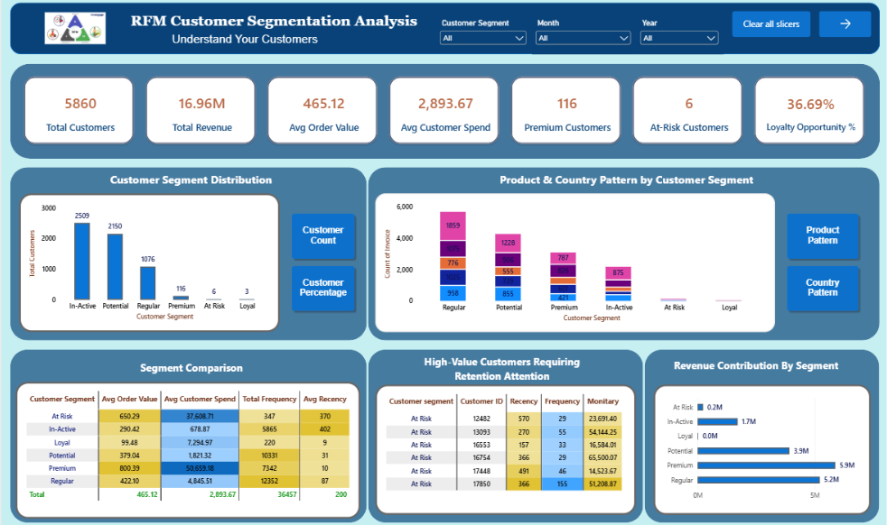
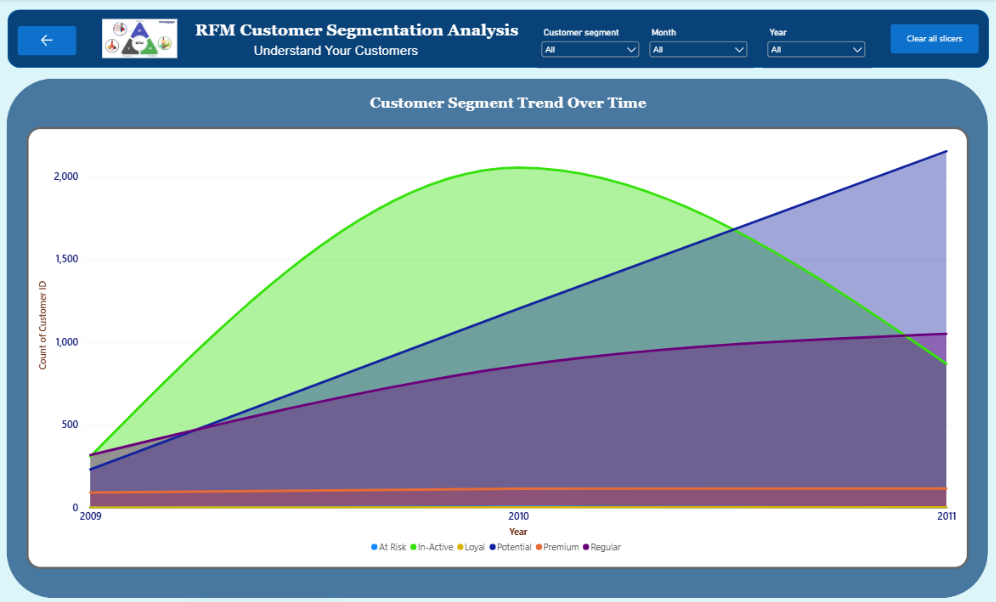

# Customer Segmentation Analysis Using RFM | Python & Power BI

---

## 1. Project Overview

### Project Objective

The primary objective of this project is to analyze customer purchasing behavior using the **RFM (Recency, Frequency, and Monetary) framework** to identify valuable customer segments, understand purchasing patterns, and support data-driven customer retention and growth strategies.

Using **Python** for data cleaning, preparation, transformation, exploratory data analysis (EDA), and RFM-based customer segmentation, along with **Power BI** for interactive dashboard development, this project provides insights into customer engagement, purchasing behavior, revenue contribution, and opportunities for customer retention and reactivation.

---

## 2. Tools & Technologies

| Tool / Technology | Purpose |
|---|---|
| Python | Data analysis and preparation |
| Pandas | Data cleaning, manipulation, transformation, and RFM analysis |
| NumPy | Numerical operations and calculations |
| Jupyter Notebook | Python development and analysis |
| Power BI | Interactive dashboard development and visualization |
| DAX | KPI calculations and analytical measures |

---

## 3. Business Requirements

### 3.1 Business Objectives

The project focuses on addressing the following business requirements:

- Develop a customer-level RFM framework using purchase recency, frequency, and monetary value.
- Classify customers into actionable segments: Premium, Loyal, Potential, Regular, At Risk, and Inactive.
- Measure the number and percentage of customers across different segments.
- Analyze revenue contribution and revenue share by customer segment.
- Compare purchase frequency, Average Order Value (AOV), customer spending, and recency across segments.
- Identify high-value customers who have not purchased recently and may require retention efforts.
- Identify low-frequency and low-spending customers with opportunities for further engagement.
- Analyze product preferences and customer distribution across countries.
- Evaluate customer segment trends over time.
- Provide data-driven recommendations for customer retention, reactivation, loyalty, and growth strategies.

### 3.2 Key Performance Indicators (KPIs)

| KPI | Purpose |
|---|---|
| Total Revenue | Measures overall revenue generated |
| Total Customers | Measures the unique customer base |
| Average Order Value (AOV) | Measures average revenue per order |
| Average Customer Spend | Measures average spending per customer |
| Premium Customers | Tracks the number of high-value customers |
| At-Risk Customers | Identifies customers requiring retention attention |
| Potential-to-Loyal Opportunity % | Measures the proportion of Potential customers who represent an opportunity for loyalty development |

---

## 4. Project Workflow

### 4.1 Data Source

- Downloaded the customer transaction dataset from Kaggle.
- The dataset contains over 10,000 transaction records.
- The dataset includes customer transactions, product information, purchase dates, quantities, prices, and country details.

### 4.2 Data Cleaning

Performed basic data quality checks to ensure the dataset was suitable for analysis.

**Activities performed:**

- Checked column data types and converted the InvoiceDate column from string to datetime format.
- Identified and handled missing values in the Customer ID column.
- Checked for duplicate records.
- Filtered out invalid transactions with non-positive Quantity and Price values.
- Created a cleaned dataset for further analysis.

### 4.3 Data Transformation

- Created a Revenue column by multiplying Quantity by Unit Price.

  **Revenue = Quantity × Unit Price**

- Prepared customer-level data for RFM analysis.
- Calculated the three RFM metrics:
  - **Recency:** Number of days since the customer's last purchase.
  - **Frequency:** Total number of purchases made by the customer.
  - **Monetary:** Total revenue generated by the customer.

### 4.4 RFM Scoring & Customer Segmentation

Assigned scores to Recency, Frequency, and Monetary values based on predefined thresholds.

Customers were classified into six segments using rule-based segmentation logic:

| Customer Segment | Segmentation Criteria |
|---|---|
| Premium | R ≥ 4, F ≥ 4, M ≥ 4 |
| Loyal | R ≥ 3, F = 5 |
| Potential | R ≥ 4, F < 3 |
| At Risk | R ≤ 2, F ≥ 4, M ≥ 4 |
| Inactive | R ≤ 2, F ≤ 2, M ≤ 2 |
| Regular | All other combinations |

### 4.5 Power BI Integration

Connected Power BI directly to the MySQL database using the database connector and imported the required customer transaction and segmentation data for dashboard development.

### 4.6 DAX Measures

Created DAX measures to calculate and display key business performance indicators, including:

- Total Revenue
- Total Customers
- Average Order Value
- Average Customer Spend
- Premium Customers
- At-Risk Customers
- Potential-to-Loyal Opportunity Percentage

### 4.7 Power BI Dashboard Development

Developed an interactive dashboard to present customer segmentation analysis and business insights in a structured and easy-to-understand format.

**KPI Cards**

The dashboard includes the following key performance indicators:

- Total Revenue
- Total Customers
- Average Order Value
- Average Customer Spend
- Premium Customers
- At-Risk Customers
- Potential-to-Loyal Opportunity %

**Visualizations**

| Visualization | Purpose |
|---|---|
| Stacked Column Chart | Compares customer distribution across segments |
| Bar Chart | Analyzes customer and product-related performance |
| Table | Displays detailed customer segmentation information |
| Area Chart | Tracks customer segment trends over time |

**Interactive Slicers**

Added interactive slicers to enable dynamic dashboard filtering:

- Month
- Year
- Customer Segment

---

## 5. Key Insights & Business Recommendations

The following insights were derived from the RFM customer segmentation analysis and Power BI dashboard.

### Insight 1: Customer Segmentation Distribution

- **Insight:** The Inactive segment accounts for the largest proportion of customers (42.82%), indicating a significant opportunity for customer reactivation. Meanwhile, the Premium segment consists of only 113 customers, highlighting the importance of retaining high-value customers.
- **Business Recommendation:** Implement targeted reactivation campaigns for Inactive customers and introduce exclusive loyalty benefits to retain Premium customers and strengthen long-term customer relationships.

### Insight 2: At-Risk Customer Analysis

- **Insight:** The analysis identified 6 At-Risk customers with monetary values ranging from approximately ₹14K to ₹55K. Their recency values indicate varying periods of purchase inactivity, suggesting a potential risk of declining customer engagement despite their historical spending.
- **Business Recommendation:** Prioritize high-spending At-Risk customers for personalized win-back campaigns, exclusive offers, and targeted communication to encourage repeat purchases and reduce the risk of losing valuable customers.

### Insight 3: Revenue Contribution Across Customer Segments

- **Insight:** The Premium segment generates the highest revenue (approximately ₹5.9M) despite having only 113 customers, highlighting its significant contribution to overall business revenue.
- **Business Recommendation:** Focus on retaining Premium customers through personalized experiences, exclusive rewards, and loyalty programs while identifying opportunities to develop other customer segments into higher-value groups.

### Insight 4: Product Preferences Across Customer Segments

- **Insight:** Regular, Potential, and Inactive customers primarily purchased the *White Hanging Heart T-Light Holder*. Premium customers showed a preference for the *Regency Cakestand 3 Tier*, At-Risk customers for the *Wooden Frame Antique White*, and Loyal customers for the *Small Popcorn Holder*.
- **Business Recommendation:** Develop segment-specific product recommendations and targeted promotional campaigns based on purchasing preferences to encourage repeat purchases and improve customer engagement.

### Insight 5: Customer Distribution and Inactive Customers by Country

- **Insight:** The United Kingdom has the highest customer count across all segments compared with other countries. However, a significant proportion of its customers belong to the Inactive segment, indicating an opportunity for customer reactivation.
- **Business Recommendation:** Prioritize re-engagement campaigns for Inactive customers in the United Kingdom through personalized offers and targeted marketing. Additionally, explore opportunities to expand the customer base and improve engagement in other countries.

### Insight 6: Customer Segment Trends Over Time

- **Insight:** The Potential and Regular customer segments showed consistent growth over the three-year period, while the Inactive segment experienced considerable fluctuations. This highlights opportunities to improve customer engagement and convert Potential and Regular customers into higher-value segments.
- **Business Recommendation:** Implement targeted marketing campaigns, personalized offers, and loyalty programs to reactivate Inactive customers, encourage repeat purchases, and convert Potential and Regular customers into Loyal and Premium segments.

---

## 6. Business Impact

The RFM Customer Segmentation Dashboard provides a structured view of customer purchasing behavior and helps business stakeholders:

- Identify high-value customers and understand their contribution to overall revenue.
- Monitor customer engagement and purchasing patterns across different segments.
- Identify At-Risk and Inactive customers for targeted retention and reactivation initiatives.
- Understand product preferences and customer distribution across countries.
- Discover opportunities to increase repeat purchases and develop customer loyalty.
- Make informed business decisions using interactive visualizations and data-driven insights.

---

## 7. Author

**Krishna Belwal**

- **Domain:** Customer Analytics & Retail Analytics
- **Tools & Technologies:** Python, Pandas, NumPy, Jupyter Notebook, Power BI, DAX
- **Project Category:** Data Analytics
- **Project Type:** Customer Segmentation & RFM Analysis

